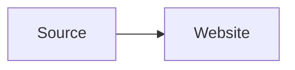

# BL-051: Technical Diagram Sources

## Purpose And Status

Let documentation authors write Mermaid diagrams in page Markdown and publish
readable diagrams with a level of usability comparable to established
documentation systems.

**Status: Prioritized by the owner on 2026-10-03; needs implementation design.**
The decision to add Mermaid support supersedes the earlier evidence gate that
required two maintained Norna sites before native rendering could be pursued.
Existing managed SVG remains useful for diagrams authored elsewhere.

## Evidence

[Docusaurus](https://docusaurus.io/docs/markdown-features/diagrams) renders
Mermaid fences and supports Light/Dark themes.
[Material for MkDocs](https://squidfunk.github.io/mkdocs-material/reference/diagrams/)
also renders Mermaid fences and describes responsive and appearance limits by
diagram type. Norna currently publishes pre-rendered SVG through its managed
image model, but does not render Mermaid source in Markdown.

## Scope And Preliminary Syntax

Use the established fenced language form unless a concrete parser conflict is
found:

````md

````

Do not introduce `norna-diagram` or a general diagram plugin API. Start with
the common flowchart, sequence, class, state, and entity-relationship cases;
document which other Mermaid diagram types are supported. A valid fence must
produce a diagram in preview and in the published site, not a raw code block.
Keep the editable Mermaid source in `content.md`.

## Open Decisions

- Compare build-time output with a page-scoped client renderer. Choose a
  bounded dependency and caching model; diagrams must remain meaningful in
  print and without JavaScript, and pages without diagrams should carry no
  Mermaid runtime.
- Define how an author supplies an accessible name and longer description
  when the visual diagram alone is insufficient. Keep text alternatives close
  to the diagram in reading order.
- Specify Light/Dark colors, narrow-screen fitting or scrolling, zoom or
  inspection when detail is too small, and behavior after an appearance change.
- Define validation and source-location diagnostics for malformed Mermaid and
  unsupported diagram types. Review links and HTML embedded in diagram source
  against [BL-163 Author HTML Publication Boundary](BL-163-author-html-publication-boundary.md).
- Decide how generated assets are cached and whether they belong to the image
  manifest; preserve deterministic builds and source provenance.

## Ready For Implementation When

- A bounded renderer and source contract cover common Mermaid diagram types,
  invalid input, cache behavior, and generated assets.
- Representative examples verify desktop/mobile, Light/Dark, print,
  no-JavaScript reading, and assistive-technology text alternatives.
- The Examples and reference placement distinguish Mermaid from standard
  Markdown, GFM and other Norna extensions.
