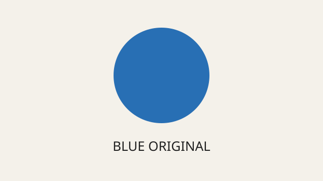

---
navigation:
  order: 3000
---

# BL-159 Markdown images

## Same image, three paths




## Shared definition

![Full reference][blue]

![blue][]

![blue]

## Reference-only image

![Used only through a definition][reference-only]

## Compare with a stack

```image-stack
items:
  - image: blue.svg
    alt: Blue circle in a Norna stack
    caption: A visible caption; the Markdown title above is a hover title.
```

## Test steps

1. Use **Go to Definition** on each path form and the reference definition.
2. Inspect **References** for `reference-only.svg`; it must count as used.
   Choose Delete, inspect the warning and cancel.
3. Add unsaved prose. Rename `blue.svg` to `blue-renamed.svg` in Site Tree.
4. Check path prefixes, definition, alt text and titles. The shared definition
   changes once; the image-stack entry also follows the rename.
5. Try text Undo, then Redo; save, close and reopen. Unsaved prose must survive.
6. Save and move this page as the last child of **Move destination**.
   Preview it there: images must still render and their files move with the page.

[blue]: images/blue.svg "Shared image title"
[reference-only]: ./images/reference-only.svg "Reference-only title"
